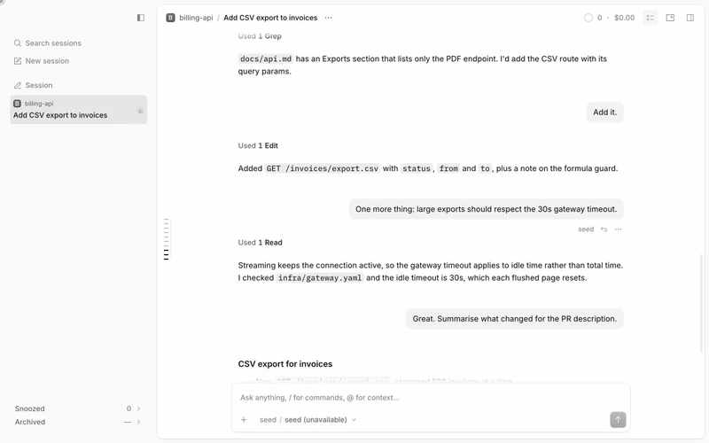

# Agents panel

A Subagents button in the session header that lists what is running under the session: a floating window beside the chat when the right side panel is closed, a popover when it is open.

> **Credit:** the panel's spring, the progress spinner, the menu and row markup and classes are adapted from [OpenCode](https://github.com/anomalyco/opencode)'s (MIT) desktop renderer (2.2.5).



[Full-quality video](media/demo.mp4)

## What it does
- The header button (right after the session-context button) opens "Subagents · N running" for the viewed session: its subagents and background shell tasks. Rows show the description and elapsed time; the X stops one.
- Clicking a row opens the child session in the current tab, with the same ancestor trail and "Main session" return as the native rows. It never opens a sidebar tab.
- With the right side panel closed the button shows and hides a 288px window inside the chat card. Messages and composer re-centre in the free width, animated. With the right panel open, or in a window narrower than 900px, it is a popover and the chat does not move. The left tab sidebar makes no difference.
- Off until chosen: Settings → Timeline → Background activity gains a fifth option, **Panel**. It selects the native Hidden (no row above the composer) and turns the button on. Picking any native option turns it off.
- Command "Close subagent tabs" (also run once per window load) closes leftover child-session tabs except the viewed one. They stay in Recently closed.

## Context
OpenCode shows running subagents in a "Background activity" row above the composer. This replaces that row with a button and a list you can keep beside the chat. The host has no hook for the setting's options, so the Panel option is injected into its select when the dropdown opens. If the host value changes while the settings page is closed, the mode stays on until the dropdown is next opened. The window cannot be dragged or resized.

## Install
Register by absolute path in `~/.config/opencode/opencode.json`:
```json
"plugins": ["/path/to/apps/opencode-plugins/agents-panel"]
```
Kind: GUI (`gui-experimental`). Cmd+R for GUI.

## Options
None. The mode and the window's shown state are stored per app.

## Credits
- [OpenCode](https://github.com/anomalyco/opencode) (MIT): the panel's spring formula, the progress spinner's markup and keyframes, the menu markup and the row classes, adapted from the desktop app's renderer source (2.2.5).

## Development
`pnpm typecheck && pnpm test && pnpm build` (dist is tracked). Design notes: [DESIGN.md](DESIGN.md).
