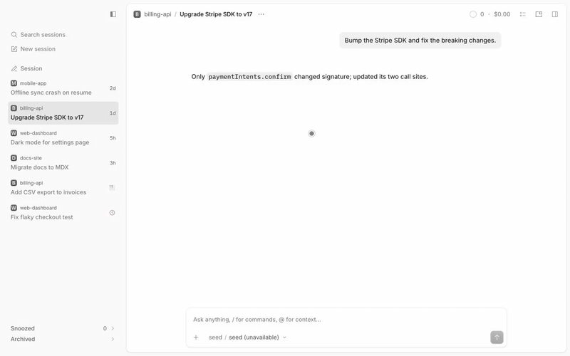

# Archive

An **Archived** group at the bottom of the sidebar, and **Archive** next to Delete in every session menu and on every tab.



## What it does
- **Archive** and **Restore** use OpenCode's native archive state. Opening an archived row reads it without unarchiving.
- Archived rows have their own **Restore** and **Delete…** (always confirmed) in their own menu. A tab shows a single Archive
  button on hover, in place of the app's close X.
- Archived loads lazily. Each group shows 10 rows and **Show N more** adds the next 25. The Archived header shows no count,
  because the total isn't known until every page is loaded.
- **Sending a message** into an archived session unarchives it at once. Messages from anything else (assistant output,
  subagents, peer messages, monitor and scheduler wakes) never unarchive.
- **Delete session…** in the palette comes from the [snooze](../snooze) plugin when both are installed, so the two never list
  the same command twice. With archive installed alone, the host's own delete command covers it.

## The two plugins
`archive` and [`snooze`](../snooze) are independent: each works installed alone, and neither needs the other. They share the
group stack, the session-menu extension and the native archive call through [session-ui](../session-ui), and each extends a
session menu under its own marker, so Snooze and Archive sit side by side in one menu.

## Install
Register by absolute path in `~/.config/opencode/opencode.json`:
```json
"plugins": [
  "/path/to/apps/opencode-plugins/archive",
  "/path/to/apps/opencode-plugins/snooze"
]
```
Kind: GUI (`gui-experimental`). Cmd+R for GUI. The group needs the Side tabs layout; the palette commands work in any layout.

## Options
| Option | Default | |
|---|---|---|
| `archive` | `auto` | `auto`: yield to OpenCode's own archive UI (its own archived group, or an Archive item of its own for our Archive actions). `ours`: always show ours. `theirs`: always stand down. |

```json
"plugins": [{ "package": "/path/to/apps/opencode-plugins/archive", "options": { "archive": "theirs" } }]
```

## When OpenCode adds archive UI
OpenCode 2.2.5 stores archived sessions but has no archive UI in its Side tabs sidebar, its menus or its palette. Its
experimental Inbox layout has an Archived section and an Archive menu item of its own; that layout shows none of this plugin's
groups, so it does not count. In `auto` the plugin watches for the host's own:

- **Menu**: a session menu (tab, header, Home row) that already has an Archive or Unarchive item. Our menu item is then left out
  of that menu.
- **Home**: the Home row's `data-action="home-session-archive"` button.
- **Sidebar**: an archived group inside the Side tabs sidebar (`data-slot` or `data-component` containing `archived`).

A host **Archive action** (the menu item or the Home button) makes our Archive actions stand down: the Archive menu items, the
hover Archive button (the host's close X comes back) and the Archive palette command. The snooze plugin's Snoozed row keeps its
own Archive, because that is a direct native API call rather than this plugin's UI. It does not make the **Archived** group
stand down, because the group is how you browse and restore what was archived.
Only a host **archived group** in the sidebar does that, and then the Refresh palette command goes too. It is live: the group
stays mounted but hidden, nothing is fetched while it is down, and it comes back, and loads what it missed, when the host's UI
goes away. The sidebar root carries `data-sa-archive="ours|theirs"` (the group) and, when a signal fired,
`data-sa-standdown="menu,home,sidebar"` naming it.

A bound `session.archive` keybind is not a signal: OpenCode answers keybind lookups from a stored catalog of commands that
includes ones of older builds, so it cannot tell a live command from a stale one.

Archive and Restore call the client's own `session.archive` / `session.unarchive` when it has them, else
`session.update({ archived })`, then check the server's state.

### Re-check on each OpenCode update
- **SDK**: do `client.session.archive` / `unarchive` exist, and with which argument (the plugin assumes `{ sessionID }` and
  falls back to `update` on any error)? Does `session.list({ archived: true })` still work?
- **Commands**: whether the host registers an archive command (its bundle has no `session.archive` id in 2.2.5). Not detectable
  from a keybind (see above); look for the menu item or button it would come with.
- **Menus**: the label or `data-action` of the host's Archive item in the tab, header and Home row menus (`hasNativeArchive`).
- **Sidebar**: the `data-slot` / `data-component` of an archived group in the Side tabs sidebar (`SIDEBAR_ARCHIVED`). The probe
  is scoped to `[data-slot="vertical-tabs-sidebar"]`.
- **Home**: whether `SHOW_HOME_SESSION_ARCHIVE` is on (`home-session-archive`).
- **Composer stamp**: `session.inbox.enqueued` items from the composer carry `payload.metadata.displayText` (`isUserSend` in
  `session-ui`); other senders stamp their own keys. If a release drops it, sends stop unarchiving.
- **Layouts**: whether the Inbox layout's Archived section moves into Side tabs.

## Credits
- [OpenCode](https://github.com/anomalyco/opencode) (MIT): the menu markup, adapted from the desktop app's renderer source
  (2.2.5).

## Development
`pnpm typecheck && pnpm test && pnpm build && pnpm smoke` (dist is tracked). Design notes: [DESIGN.md](DESIGN.md). The shared
sidebar and menu code is [session-ui](../session-ui); install once in `apps/opencode-plugins`.
