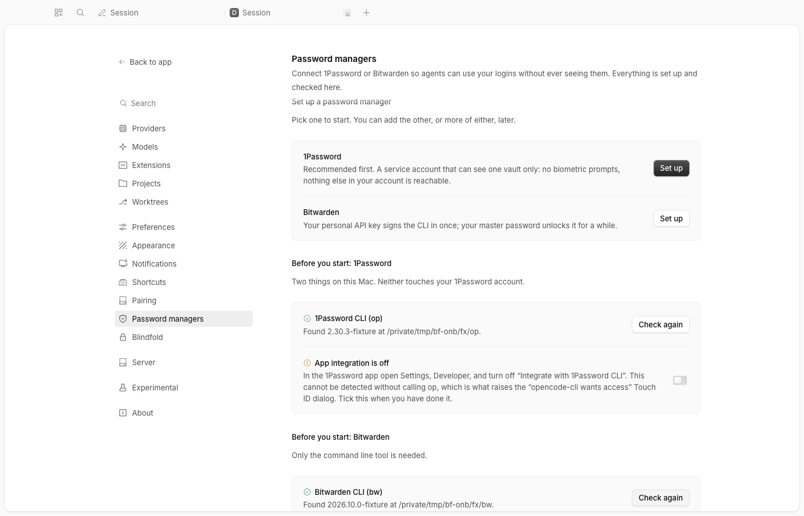
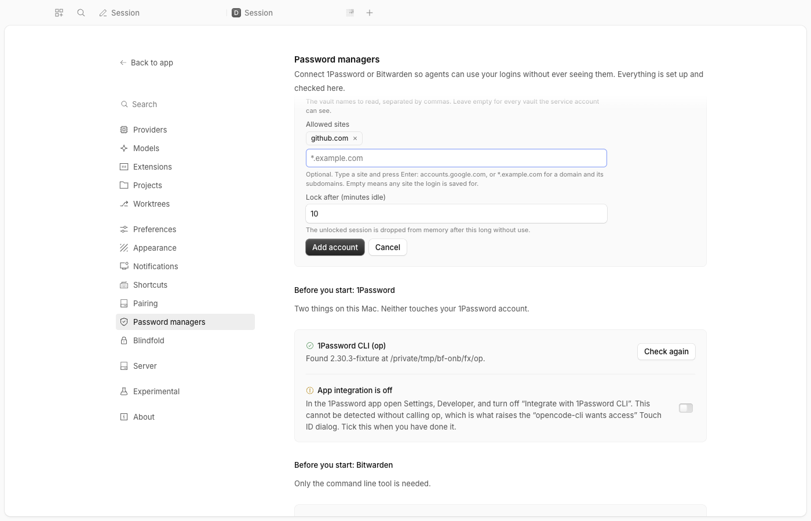
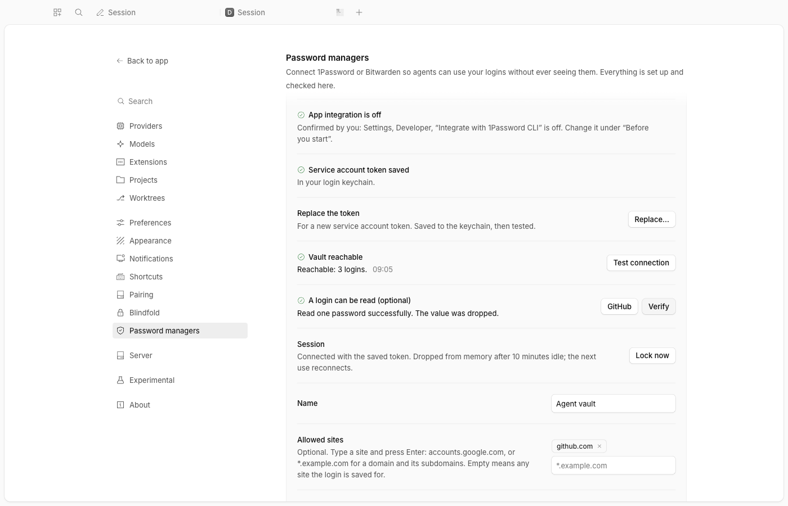
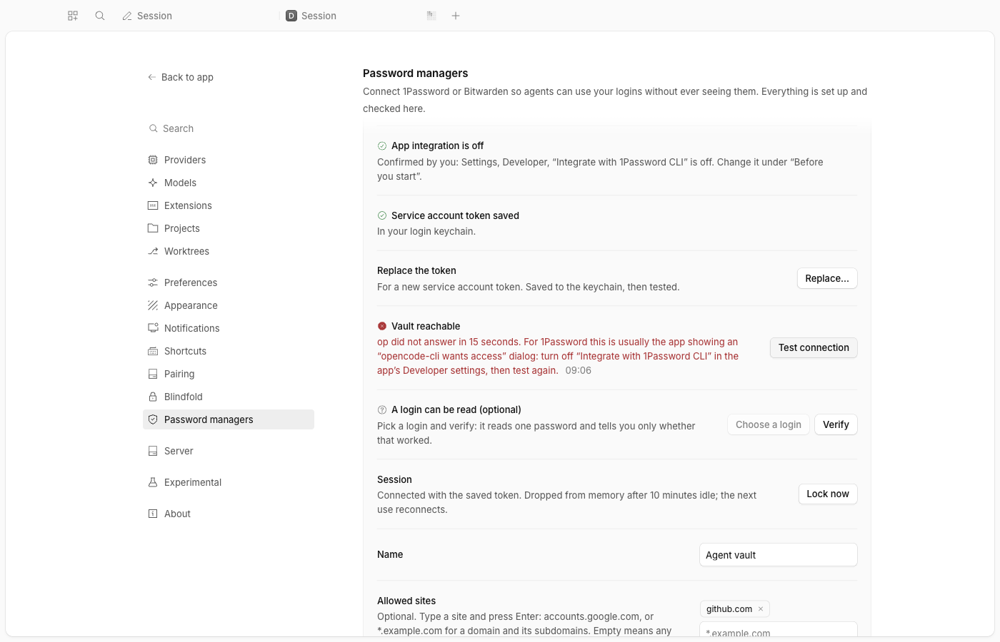
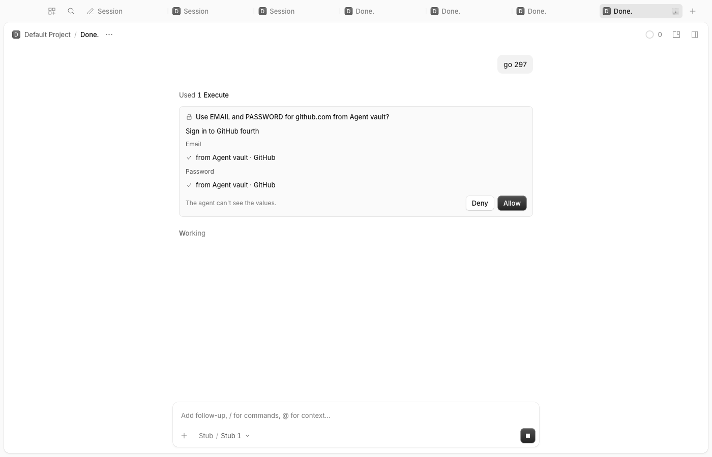
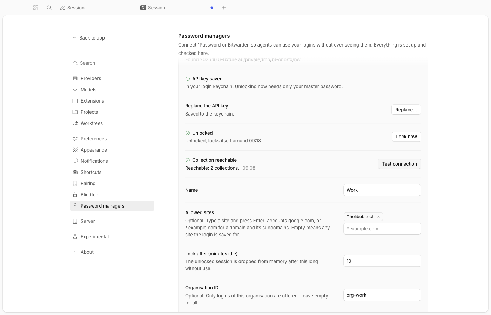

# Blindfold providers

1Password and Bitwarden side by side behind blindfold's card: an agent asks for a login, you approve it once, always or never, and the value goes to the page or the running code, never to the chat.

> **Credit:** a companion to our [blindfold](../blindfold) fork of [vimtor](https://github.com/vimtor)'s [opencode-blindfold](https://github.com/vimtor/opencode-plugins/tree/main/packages/opencode-blindfold) (MIT). The redaction idea is vimtor's. The CLI behaviours are from the vendors' docs: [1Password CLI](https://www.1password.dev/cli/) and [service accounts](https://www.1password.dev/service-accounts/get-started.md), [Bitwarden CLI](https://bitwarden.com/help/cli/). Nothing here has been run against a real `op` or `bw` yet: see Not measured.

## What it does
- **Accounts you name.** `personal` can be 1Password and `work` Bitwarden, or two of one kind. Each registers with blindfold, which shows them on its card with the label you gave ("Work (Bitwarden)"). You add them on a Settings page, with a live checklist, no JSON.
- **No biometrics, no app dialog.** 1Password goes through a service account on one vault you choose; every `op` call turns the desktop-app integration off, so the "Allow opencode-cli" dialog never appears. Bitwarden uses its API key once, then your master password.
- **Locks itself.** Sessions live in memory only and lock after 10 idle minutes (per account). A locked account shows its unlock inside the card; a master password or token you type is sent once and forgotten.
- **Fenced.** An account with `allowedOrigins` serves only those sites, so a work login never fills a personal page.
- **Never a value in the open.** Secrets reach a CLI only on stdin or in its environment, never in a command line. Errors carry the CLI's first line with your input scrubbed out.

## Context
OpenCode has no password-manager hook. Blindfold already keeps secrets out of the model's context; this plugin gives it vaults to read from and a Settings page to connect them. The card, the rules and the audit trail are blindfold's. A third vendor is another plugin registering through the same contract.

## Install
Register by absolute path in `~/.config/opencode/opencode.json`, together with blindfold (order does not matter). No options are needed:
```json
{ "package": "/Users/isaac/git/dev-files/apps/opencode-plugins/blindfold-providers" },
{ "package": "/Users/isaac/git/dev-files/apps/opencode-plugins/blindfold" }
```
Restart the background service once for the first load (`opencode service restart`): the plugin has a GUI half now, and a service that resolved the directory without one keeps ignoring it. After that, everything below happens in the app with no restart. The service needs `op` and, for an npm-installed `bw`, `node` on its PATH (`/opt/homebrew/bin` is on it today).

## Open Settings > Password managers
Everything is on one page, top to bottom (or run the command **Password managers: set up**):



1. **Pick a provider** (Set up). Fill the form: a name, the secret (masked, with an eye toggle), the vault or organisation, the sites it may fill (type a site, press Enter) and the idle lock time. Each field has a one-line help text saying where to find it. Secrets go to the plugin once and into your macOS login keychain; the page forgets them the moment you press Add.

   
2. **Read the checklist** of the new account. Each step is green, amber (yours to do), red or not tried yet, with a button where there is one:

   

   | 1Password | Bitwarden |
   |---|---|
   | `op` installed (only `which op` and `op --version` run) | `bw` installed (the exact `brew install bitwarden-cli` with a Copy button when missing) |
   | App integration is off: a box you tick (it cannot be detected without calling `op`, which is what raises the Touch ID dialog); the page gives the menu path | API key saved |
   | Service account token saved | Unlocked: your master password, masked; locks after N idle minutes; held in memory only |
   | Vault reachable: **Test connection** lists the vault's logins (a count) with a 15 second limit | Collection reachable: **Test connection** |
   | A login can be read: pick a title, **Verify** reads one password and says only ok or not | |

   A failed test says what to do. A timeout on 1Password is almost always the desktop app's dialog:

   
3. **Create the Agent vault** (panel at the bottom of the page): the numbered steps, buttons that open the right 1Password pages, and what to copy back (only the token). Bitwarden: Settings, Security, Keys, View API key.
4. Ask an agent to use a login. The card names the account; **Always allow** and the rules are on blindfold's page.

   

Per account you can rename it, change its sites and idle lock time, **confirm every use** (the card then offers only Deny and Allow), turn it off without deleting anything, replace its credential, and remove it (this deletes its keychain items; revoke the service account or API key in the vendor's site too).



An account in `opencode.json` `options.accounts` still works and shows on the page marked "from opencode.json", read-only. If the same id is in both, the option wins.

### Where things are kept
| What | Where |
|---|---|
| Account settings (name, sites, lock time, vaults) | `~/.config/blindfold/accounts.json`, mode 0600. Per user, not per project. No secret in it |
| 1Password service token | login keychain item `blindfold-op-<id>`, written through `security -i` on stdin |
| Bitwarden API key | keychain items `blindfold-bw-id-<id>` and `blindfold-bw-secret-<id>` |
| Bitwarden master password | nowhere: typed, sent once, forgotten |
| Sessions | memory only, dropped after the idle time |

## Options
Optional. Everything below can still be set in `~/.config/opencode/opencode.json` instead of on the page. Per account, under `accounts.<id>` (id: lowercase letters, digits, `-` or `_`):

| Option | Default | What it does |
|---|---|---|
| `provider` | required | `1password` or `bitwarden` |
| `label` | `<id> (1Password)` / `<id> (Bitwarden)` | what the card shows |
| `autoLockMinutes` | `10` | idle minutes before the in-memory session is dropped (Bitwarden also runs `bw lock`) |
| `allowedOrigins` | any site the item is saved for | host patterns this account may fill: `accounts.google.com`, `*.example.com` (that domain and subdomains), or `http://localhost:3000`; https only unless written out |
| `confirmEveryUse` | `false` | no Always allow for this account; every use asks |
| `alwaysAllowOtp` | `false` | Always allow on a sign-in may include the one-time code; off, a code asks every time even under a saved rule |
| `bin` | `op` / `bw` | the CLI to run |
| `unlock` (1Password) | `serviceAccount` | `serviceAccount`, or `masterPassword` (whole account; not verified against the real CLI) |
| `vaults` (1Password) | all the token can see | vault names to list |
| `tokenStore` (1Password) | `keychain` | where the service token rests: the macOS login keychain, `memory`, or the path of a `security` binary |
| `tokenEnv` (1Password) | none | an environment variable of the service that holds the token (the keychain is looked at first) |
| `address`, `shorthand` (1Password) | `my.1password.com`, the id | for `masterPassword` |
| `appDataDir` (Bitwarden) | `~/.config/blindfold/bw-<id>` | one data directory per account (`BITWARDENCLI_APPDATA_DIR`) |
| `organizationId` (Bitwarden) | any | only items of this organisation |
| `syncOnUnlock` (Bitwarden) | `true` | `bw sync` after unlocking |

Plugin-level options (mostly for tests): `accountsFile` (the settings file), `tokenStore` (where the page puts credentials: `keychain`, `memory` or a `security` path), `bins` (`{ "1password": "/path/op", "bitwarden": "/path/bw" }`).

Which account serves which site is set in blindfold's `rules` option (see its README).

## Not measured
Nothing here has been run against a real `op` or `bw`. The page's **Test connection** and **Verify** are how you find out: the error messages map the vendors' documented wording (rate limit, bad token, unknown vault, the app prompt) and an unrecognised failure shows the CLI's own first line. `node check.mjs` still does the same from a terminal. The Bitwarden `list collections` call and the 1Password timeout-as-app-dialog reading are from documentation and fixtures only.

## Credits
- [vimtor/opencode-plugins](https://github.com/vimtor/opencode-plugins) (MIT): the blindfold idea and redaction this builds on, through our fork.
- 1Password and Bitwarden documentation: the CLI flags, the service-account limits and the `bw unlock --passwordenv` path (cited in [DESIGN.md](DESIGN.md) §1).

## Development
`pnpm typecheck && pnpm test && pnpm build` (dist is tracked), `pnpm smoke`. `harness/up.sh` and `harness/down.sh` start and stop a private app with the page on its own ports (CDP 9481, service 49681, stub 49887; override with `ONB_CDP`, `ONB_SVC`, `ONB_STUB`). The fixture `op`, `bw` and `security` are in `fixture-cli/`; the browser side is exercised by `../blindfold/harness/run-providers.sh`. Design notes and evidence: [DESIGN.md](DESIGN.md).
