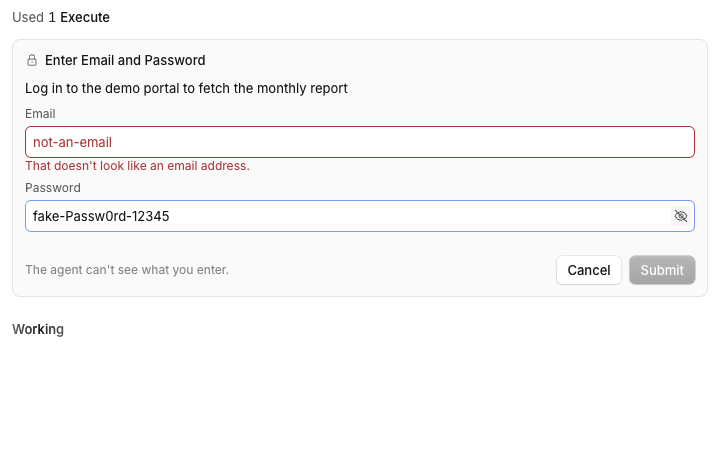

# Blindfold

Agents ask for a secret, or a whole login, in a card inside the chat. You type it there and the agent never sees it.

> **Credit:** a fork of [vimtor](https://github.com/vimtor)'s [opencode-blindfold](https://github.com/vimtor/opencode-plugins/tree/main/packages/opencode-blindfold) 0.5.0 (MIT, pinned at `9d1e947`). The idea, the redaction and the server side are vimtor's; the request card, the multi-field tool and the TUI prompts are ours. Please star and use the original too. See [PROVENANCE.md](PROVENANCE.md).



## What it does
- **One tool, one or several inputs.** `get({ name })` returns the value as before. `get({ fields: [{ name: "EMAIL" }, { name: "PASSWORD" }], reason })` asks for both in one card and returns an object keyed by name. The agent never gets the values in chat: Code Mode hands them to the running code only, and a shell command receives one as an environment variable only when it names it.
- **A card in the thread, not a dialog.** It sits under the tool call that asked, in the reading column, with the field labels and the agent's reason. The composer stays usable and nothing is blocked. Focus goes to the first empty field (unless you are typing in the composer). Enter submits, Escape declines, and Escape does not stop the run.
- **Masked by default.** A field is masked unless its kind is `text` or `email`, or its name reads as plain (`EMAIL`, `USERNAME`, `LOGIN`). A name like `PASSWORD`, `TOKEN`, `KEY` or `SECRET` stays masked even if the agent calls it `email`. A masked field has an eye to reveal and hide it.
- **Light checks, never your value back.** An email that cannot be one (no `@`, spaces inside) blocks Submit and says so; one with no domain ending only warns; a secret with a leading or trailing space warns. The message never repeats what you typed.
- **Quiet when done.** After you answer, the card becomes one line, `Secrets provided  EMAIL and PASSWORD`, with no values and no toast. Declined or expired requests show as a muted line. Only a failure toasts.
- **Redaction covers every field.** Each value, and its JSON, URL, base64 and hex forms, becomes `[REDACTED:NAME]` in tool results, errors, messages, system prompts and raw provider requests.
- **Password managers, with three choices** (with [blindfold-providers](../blindfold-providers)). `get({ fields, origin })` offers a login kept in 1Password or Bitwarden: the card says "Use EMAIL and PASSWORD for accounts.google.com from Personal (1Password)?" and you choose **Allow** (once), **Always allow** (a saved rule for that site, account and field) or **Deny** (the agent gets a denial, never a value). Two accounts hold the login: you choose, and Always allow remembers the account. A locked account shows "Work (Bitwarden) is locked" with masked inputs right in the card. An Always allow saved on a fill covers fills only. A field no vault holds is typed, as before. Set the accounts up in Settings, Password managers (a "Set up" button here opens it); an account set to confirm every use hides Always allow. Approving, remembering and unlocking never toast.
- **One card per sign-in** (`fill` only). When a vault holds the login for the page, the card for the first field is about the whole login: "Sign in to accounts.google.com", with the row `Personal (1Password) › Google · email, password, one-time code`, and **Deny**, **Always allow**, **Allow**. **Allow** approves those fields for this session, tab and site for 3 minutes, each used once; the agent keeps calling `fill` as the page steps change (email, then password, then code) and no further card appears. Anything outside it (another field, item, site, tab, or a second use) gets its own card. **Only this field** in the card turns the sign-in down for that one field. **Always allow** saves one rule for the login (email and password) shown on the rules page as "Sign in to <site> with <item>"; the one-time code always asks, unless the account turns on "Include one-time codes in Always allow". After use the answered row says "Signed in with Personal (1Password): 3 fields". `get` never offers a sign-in: its values go to the agent's code, so each stays a decision of its own.
- **Fill without the agent holding the value.** `blindfold.fill({ tabID, origin, fields })` returns a placeholder script; passed to `browser.evaluate`, it is swapped for the real one after the call is recorded, so the value never reaches the model, the agent's code or the session database. The page's fields are filled and masked (discs) along with any echo of the value, and the fill is refused on any other origin.
- **Rules you can see and revoke.** Settings, **Blindfold** (or the command "Blindfold: manage rules") lists the accounts with Lock, the saved Always-allow rules with Revoke, and the last uses. The audit trail (one JSON line per use, names only) is in `~/.local/share/opencode/blindfold/audit.jsonl`.
- **If the session is not on screen**, a toast says the agent is waiting and offers **Show**. A card survives scrolling a long thread, a page reload (it reappears, empty) and a switch of session.

## Context
OpenCode has no way for a plugin to raise a native form in the thread, so the card is injected next to the host's tool row (see [DESIGN.md](DESIGN.md)). Controls are the host's own `TextInput`, `Button` and `IconButton`. The TUI has no masked prompt, so there each field is asked in turn and shown as typed.

## Install
Register this checkout by absolute path in `~/.config/opencode/opencode.json` (server and Desktop) and `~/.config/opencode/cli.json` (TUI):
```json
{ "package": "/path/to/apps/opencode-plugins/blindfold", "options": { "shell": { "enabled": true, "approve": true }, "codemode": { "enabled": true } } }
```
Kind: server, TUI and GUI in one package. Restart the background service (`scripts/opencode-safe-restart.sh` in dev-files) for the first load; Cmd+R reloads the GUI.

## Options
`shell`, `codemode`, `secrets` and `1password` are upstream's; `rules` and `audit` are ours. The shown values are the defaults.

| Option | Default | What it does |
|---|---|---|
| `shell.enabled` | `true` | Shell commands receive a secret they name, as an environment variable |
| `shell.approve` | `true` | Each such command needs your approval |
| `shell.blockKeychain` | `true` | Refuse shell commands that read a secret from the macOS keychain (`security find-generic-password`, `find-internet-password`, `dump-keychain`), pointing the agent at `blindfold.get` |
| `codemode.enabled` | `true` | `blindfold.get` runs in Code Mode and returns the value to the code only |
| `secrets` | none | Names the user provides up front: a plain value or `op://` reference per name |
| `1password.account` | none | Account for `op://` reads when several are signed in. These reads never use the 1Password app (`OP_BIOMETRIC_UNLOCK_ENABLED=false`): they need a service account token or a signed-in session, and an unlocked blindfold-providers account serves them first |
| `rules` | none | `[{ "origin": "*.example.com", "account": "work" }, { "name": "GH_TOKEN", "account": "personal", "ref": "op://Agent/GitHub/token" }]`: which account may serve a site (a host pattern; `*.d` is `d` and its subdomains) or a secret name. A rule that names a site keeps every other account out of it; an account fenced by `allowedOrigins` never serves another site. Tag rules are not supported |
| `flowMinutes` | `3` | How long an approved sign-in stays usable (a number above 0, at most 10) |
| `audit.file` | `~/.local/share/opencode/blindfold/audit.jsonl` | where uses are logged (names, accounts, outcomes; never values); `false` keeps only the last 50 in memory |

## Development
`pnpm typecheck && pnpm test && pnpm build` (dist is tracked), `pnpm smoke`. Design notes: [DESIGN.md](DESIGN.md).

### Harness
`harness/` drives the card in the private desktop harness with a stub model (no real secret ever; the values in the scripts are fake). `harness/run-providers.sh` runs the whole provider scenario (stand-in `op`, `bw` and `security`, the in-app browser, 41 checks) in one command and stops everything after:

`harness/run-flow.sh` runs flow approval (one card for a multi-step sign-in, what still asks, Always allow, the rules page, hot reload; 32 checks, `BF_PARITY=1` adds the parity spec) on its own ports with a local page and the fixture `op`.

```sh
node harness/stub-model.mjs        # BF_CODE_FILE=<file with the Code Mode snippet> BF_STUB_LOG=<follow-up request log>
OC_HARNESS_EXTRA_CONFIG=$PWD/harness/provider.json desktop-harness.sh start $PWD
node harness/drive.mjs             # single, multi, mask, eye, validation, Enter, Escape, redaction, DOM leaves no value
node harness/drive2.mjs            # reload, long thread, session switch, themes
```
