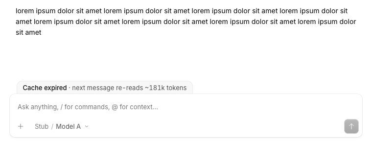
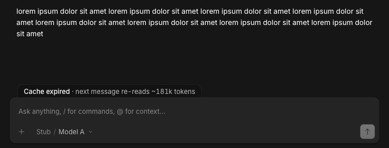

# Cache warning

A small grey tray above the composer says when your next message will re-read the whole conversation at full price: after the prompt cache has expired, after you switch model, and after a compaction.

> **Credit:** the tray is [OpenCode](https://github.com/anomalyco/opencode)'s (MIT) own `data-dock-surface="tray"` surface from its composer docks, and it opens and closes on the same spring as the queue panel (2.2.5). The cache lifetime comes from Anthropic's [prompt caching docs](https://platform.claude.com/docs/en/build-with-claude/prompt-caching): 5 minutes by default, refreshed on every use.




## What it does
- Cache expired: "Cache expired · next message re-reads ~180k tokens". The count is the size of the last measured context, written the way the context ring writes it.
- Model or variant changed in the composer: "Cache reset · model changed · next message re-reads ~180k tokens".
- After a compaction: "Cache reset · compacted · next message writes a new cache".
- Nothing while the cache is warm, nothing once you send, nothing in small contexts (under 20,000 tokens), nothing in a subagent's session, nothing when the provider never reports cache use.
- No icon, no buttons, no sound, not focusable. It slides out from under the composer and back, like the host's own docks, and never moves the composer.

## Context
OpenCode has no slot above the composer. `ComposerPill` is a focusable capsule in the pill row, so the tray goes into the composer lane the app's own pills float in (a DOM injection, see `DESIGN.md`). It follows the Background activity placement setting and sits 14px in from that edge.

The warning is a prediction, not a measurement. It assumes the provider's cache lives `cacheTtlMinutes` after the last reply ended, and it cannot see account switches, proxies that rewrite cache headers, or a provider that evicts early. A tray that shows is a probable full re-read; no tray is not a promise of a cache hit.

## Install
Register by absolute path in `~/.config/opencode/opencode.json`:
```json
"plugins": ["/path/to/apps/opencode-plugins/cache-warning"]
```
Kind: GUI (`gui-experimental`). Restart the background service (`opencode service restart`) for the first load of a GUI export and for an option change. Cmd+R for GUI.

## Options
| Option | Default | Meaning |
| --- | --- | --- |
| `cacheTtlMinutes` | `5` | Minutes the provider keeps a cache entry after its last use. Use `60` where you run Anthropic's 1 hour cache. |
| `minTokens` | `20000` | Contexts smaller than this never warn. |

```json
{ "package": "/path/to/apps/opencode-plugins/cache-warning", "options": { "cacheTtlMinutes": 5, "minTokens": 20000 } }
```

## Development
`pnpm typecheck && pnpm test && pnpm build` (dist is tracked). Design notes: [DESIGN.md](DESIGN.md). `test/seed-cache.mjs` seeds one session per state into a throwaway harness; `parity.spec.mjs` compares the tray's surface with the host's.
