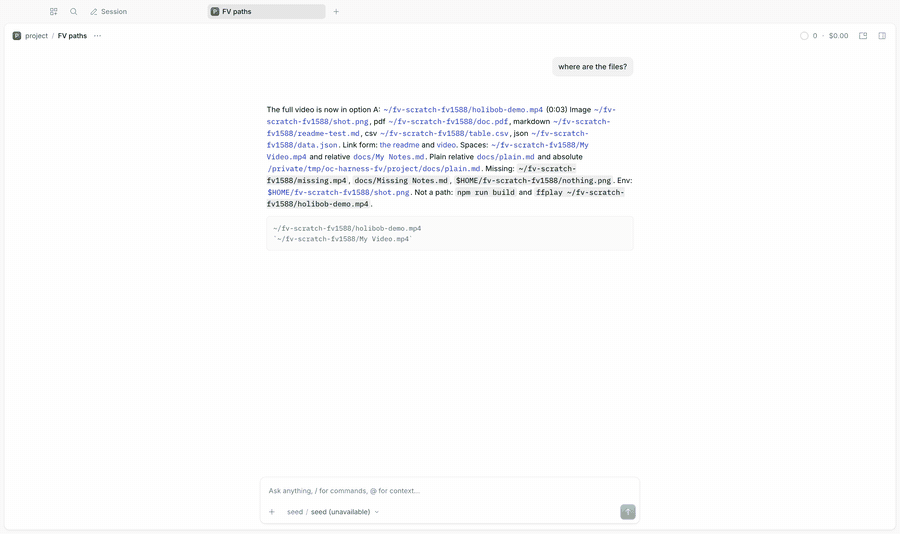

# File viewer

Click a file path in an assistant message, `~/Movies/demo.mp4` included, and it opens in the side panel's Files tab.

> **Credit:** none borrowed. It hands files to OpenCode's own Files viewer; the path grammar is original.



[Full-quality video](media/demo.mp4)

## What it does
- Makes `~/...` and `$HOME/...` paths clickable (the app refuses them) when the file exists; the video, image, PDF, Markdown, CSV or JSON opens in the same tab the app uses for any file.
- Makes names with spaces clickable in inline code (`` `~/Movies/My Video.mp4` ``, `` `docs/My Notes.md` ``), which the app skips.
- Leaves everything else to the app: relative paths without spaces still use its workspace search, missing files and code blocks stay plain.
- Keeps line selections: `~/notes.md:12` or `#L10-L20`.

## Context
OpenCode 2.2.5 already links inline code and opens images, video, audio, PDF, Markdown and CSV in a side-panel tab, but its `~` check always fails and its inline code check rejects spaces. This plugin adds a `LinkHandler` for those two cases and gives the app the absolute path. Timestamps (`#t=72`, `@1:12`) are read but ignored: the app's video viewer cannot seek. No path policy is added: the app already opens any absolute path a message names. Details and measurements: [DESIGN.md](DESIGN.md).

## Install
Register by absolute path in `~/.config/opencode/opencode.json`:
```json
"plugins": ["/path/to/apps/opencode-plugins/file-viewer"]
```
Kind: GUI plus a small server part (it reports the home directory). **The first install needs a service restart**; later rebuilds hot-reload.

## Options
| Option | Default | |
| --- | --- | --- |
| `spacedCode` | `true` | Mark inline code with spaces as a path. A DOM workaround for a host limit; costs about +14% script time during very fast scroll of a 300-turn session. `false` turns it off. |

## Development
`pnpm typecheck && pnpm test && pnpm build` (dist is tracked). Design notes: [DESIGN.md](DESIGN.md).
