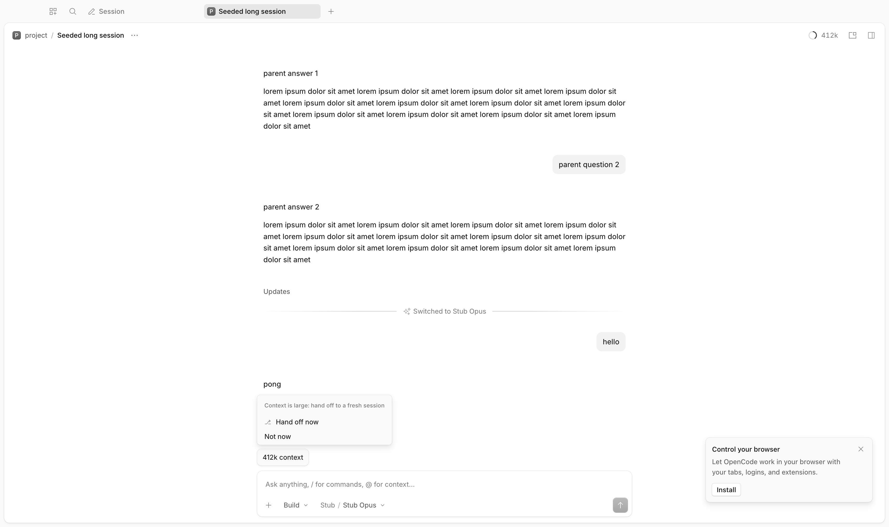

# Handoff nudge

Warns an Opus session, and you, when its context has grown big enough that a handoff to a fresh session is cheaper than
another turn. It never creates a session itself; the handoff reuses `orchestrate` ([orchestrator-tools](../orchestrator-tools)).

## What it does
- Reads every `session.step.ended` event and adds up what the next request re-sends: `input` plus `cache.read` plus
  `cache.write`. Only root sessions count, only in the project location this server instance serves, and only models the
  `models` option names (default `*opus*`).
- At each tier (`tiers`, default 200k, 400k and 700k tokens) it posts one timeline notice to the agent with
  `session.synthetic` (`delivery: "queue"`, `resume: false`), so it starts no turn: the context size, what the last cold
  wake wrote, and a handoff checklist (update `STATE.md`, write `HANDOFF-<date>.md` beside it, start the successor with
  `orchestrate create` in `independent` mode on the same agent and model, send the merger and peers its id, then stop).
  "Advice only; continue if mid-task".
- A tier fires once per session and re-arms only when the context falls below half of it, which is what a compaction does.
- A wake after more than an hour idle rebuilds the prompt cache; when its first step wrote at least `coldWrite` tokens
  (default 150k) it posts one cold-wake notice, at most once per session per 24 hours.
- Shows a warning pill above the composer ("412k context") while a tier stands. Its rows are **Hand off now**, which
  queues the same instruction as a user prompt, and **Not now**, which hides the pill until a higher tier fires. Subagent
  sessions never show it (the host hides pills there anyway).
- Publishes one `info` notification per tier through the hub in [native-ui](../native-ui): a mark when
  [notifications](../notifications) is installed, and no toast.



## Context
The spike found the Claude Agent provider fills `tokens.cache.read` and `tokens.cache.write` on `session.step.ended`
(and in `opencode.db`): a real `claude-agent/opus` message recorded `cache.read` 176040 and `cache.write` 136. A private
service with a stub OpenAI-compatible provider confirmed the event carries those numbers through to a plugin
(`input` 2000, `cache.read` 176000, `cache.write` 3000). No database query is used at runtime; a provider that reports no
cache usage simply never reaches a tier.

## Install
Register by absolute path in `~/.config/opencode/opencode.json`:
```json
"plugins": [{
  "package": "/path/to/apps/opencode-plugins/handoff-nudge",
  "options": { "models": ["*opus*"], "tiers": [200000, 400000, 700000], "coldWrite": 150000 }
}]
```
Kind: server and GUI. The GUI half republishes the server's `notify` event through the hub in native-ui. Restart the
background service (`scripts/opencode-safe-restart.sh` in dev-files); the service outlives the app, so quitting alone
does not reload it.

## Options
| Option | Default | |
|---|---|---|
| `models` | `["*opus*"]` | model ids to watch; `*` is a wildcard, matching is case-insensitive |
| `tiers` | `[200000, 400000, 700000]` | context sizes, in tokens, that each warn once per crossing |
| `coldWrite` | `150000` | cache tokens a cold wake must write before it is worth a warning |

## Development
`pnpm typecheck && pnpm test && pnpm build` (dist is tracked). Tests use a fake host and clock; the GUI half has a smoke
test. The private-service run used a stub OpenAI-compatible provider that reports large cached usage.
