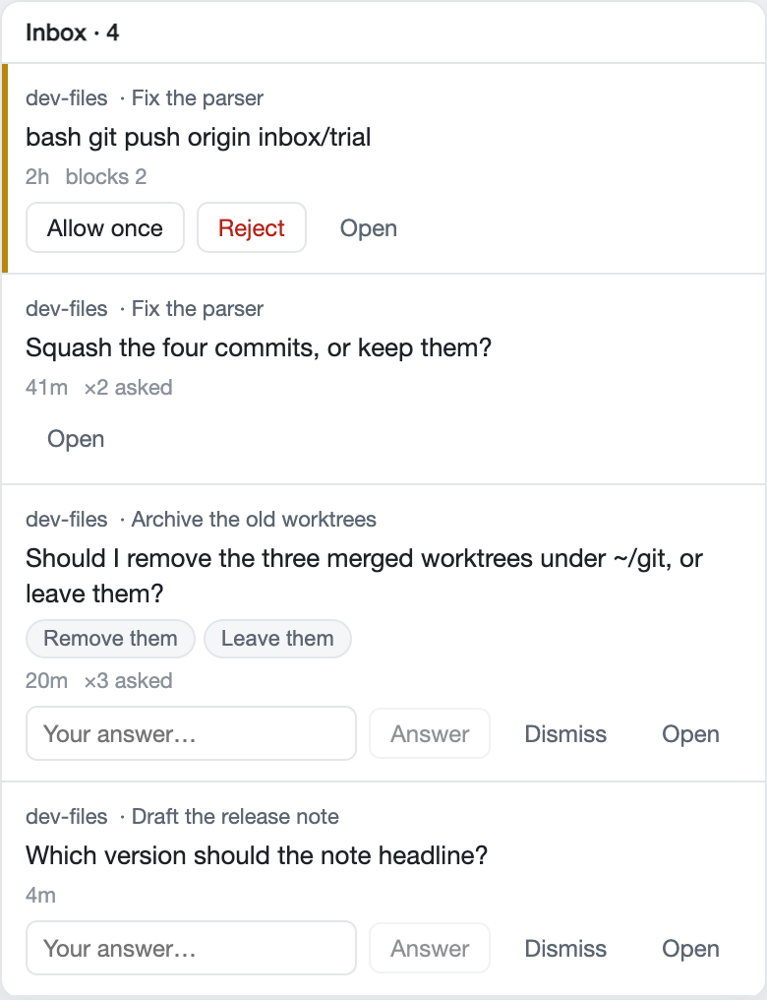

# Inbox

One list of everything waiting for Isaac — the agent's permissions, its questions, and asks that would otherwise be prose —
in a pinned side panel, with one notification instead of one per request.



## What it does
- **One panel, ranked.** A pinned side tab ("Inbox · N") in every session lists what waits, most expensive first: age ×
  whether anything is blocked × the idle sessions behind the answer + what a re-ask is worth (see [DESIGN.md](DESIGN.md)).
  Each row names the project and session, the ask, its age, `×K asked` and `blocks N`, with Open.
- **Three sources.** Pending permissions and pending question forms (the built-in `question` tool and
  `question_background` make the same form) come from every server's synced data through
  [`native-ui/src/requests.ts`](../native-ui/src/requests.ts); `ask_isaac` asks come from this plugin's server half.
- **`ask_isaac {question, options?, ref?, blocking?}`** for asks that would otherwise be prose. The tool's description
  tells the model to ask Isaac only through `question`, `question_background` or `ask_isaac`, never in prose. It returns at
  once; the answer arrives later as an `<inbox-answer>` message in the asking session.
- **Merged.** A `ref` names one ask across every session; without one the normalised question text is the identity, within
  the asker's root family. Asking again counts (`×K asked`) instead of adding an item, and an ask answered in the last day
  hands its answer straight back to the model. Built-in question re-asks are counted the same way.
- **Answer where it waits.** A permission gets Allow once / Reject, a one-question form gets its options as buttons, and an
  `ask_isaac` gets a text box and Dismiss. Open jumps to the session for anything else.
- **One notification.** A persistent "Inbox · N waiting" (through [notifications](../notifications) when installed) fires
  when what tops the list changes, or when a blocked ask passes 15 and 60 minutes, never more than once every 10 minutes.
  While the plugin runs it claims `host-requests`, so `notifications` stops raising a toast per host request; its marks and
  every other kind still show.
- A titlebar pill shows the count while something waits. Nothing is injected into a system prompt.

## Context
Several agents running at once raise requests in different sessions, and each one used to be its own toast. The inbox is the
single place that decides what to answer first. It never imports `notifications` or `question-async`: it reads the host's own
stores and publishes through the shared contract in [native-ui](../native-ui).

## Install
Register by absolute path in `~/.config/opencode/opencode.json`:
```json
"plugins": ["/path/to/apps/opencode-plugins/inbox"]
```
Kind: server and GUI. The server half owns `~/.local/share/opencode/inbox/asks.json` (or `$XDG_DATA_HOME/opencode/inbox/`
when set); the GUI half reads it over RPC. Restart the background service (`scripts/opencode-safe-restart.sh` in dev-files)
for the server half; Cmd+R reloads the panel.

## Options
All optional, in the plugin entry's `options`.

| Option | Default | |
|---|---|---|
| `notifyEveryMin` | `10` | the least time between two inbox notifications |
| `escalateMin` | `[15, 60]` | minutes at which a blocked ask raises another notification |
| `rememberAnsweredH` | `24` | how long an answered ask is remembered (a re-ask returns the answer) |
| `reaskWeight` | `30` | the minutes a re-ask is worth in the ranking, per ask after the first |

## Credits
- OpenCode (MIT): the panel's tokens and button look come from the app's own theme and `ctx.ui`.

## Development
`pnpm typecheck && pnpm test && pnpm build` (dist is tracked). Design notes: [DESIGN.md](DESIGN.md).
