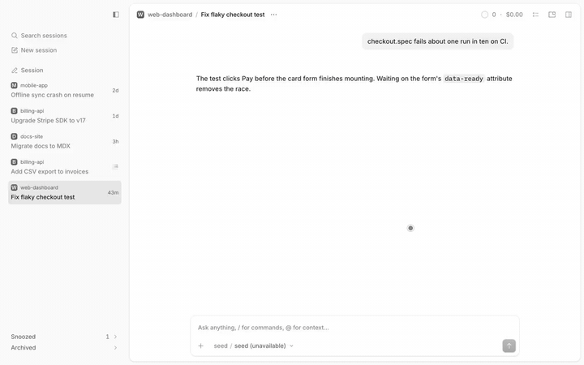

# Model picker

The Search models dialog lists providers A to Z and, inside each, models by output price, with no Recent section.

> **Credit:** the result rows and the sticky-header fade are cloned from [OpenCode](https://github.com/anomalyco/opencode)'s (MIT) own model dialog (2.2.5).



[Full-quality video](media/demo.mp4)

## What it does
- Providers run A to Z by name. Favorites stays above them.
- Models inside a provider run by output price per million tokens, highest first, ties by name. A model with no price counts as 0.
- No Recent section. A model you used recently stays under its provider instead of moving out.
- Works from every entry point (composer pill, `Cmd+'`, "Choose model", `/model`). Search, Enter, the variants flyout and favoriting behave as in the host.

## Context
This replaces the results list of OpenCode's own model dialog. The host keeps running underneath, hidden, so selection, favorites and hidden models stay its own; the plugin draws a second list from clones of its rows. It depends on the dialog's markup: if an update renames it the pane may not attach and the dialog can show an empty list: the host's list is hidden before the pane's first successful render, so there is no fallback to the host's list yet (known gap). Prices need the model list for the open session's directory, so until it loads the order falls back to name.

## Install
Register by absolute path in `~/.config/opencode/opencode.json`:
```json
"plugins": ["/path/to/apps/opencode-plugins/model-picker"]
```
Kind: GUI (`gui-experimental`). Cmd+R for GUI.

## Options
None.

## Credits
- [OpenCode](https://github.com/anomalyco/opencode) (MIT): the result-row markup (cloned at run time from the host's rows) and `fadeHeaders`, copied from the model dialog in the desktop app's renderer source (2.2.5).

## Development
`pnpm typecheck && pnpm test && pnpm build` (dist is tracked). Design notes: [DESIGN.md](DESIGN.md).
