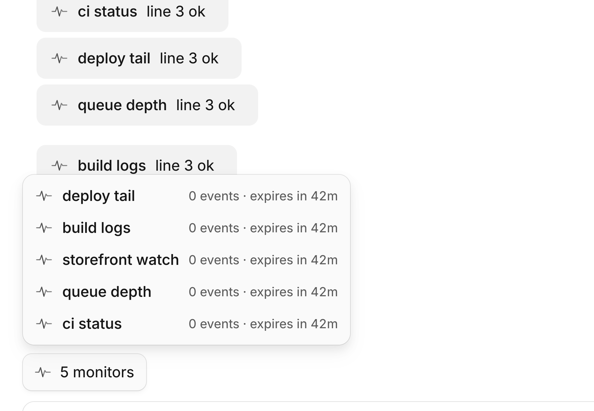
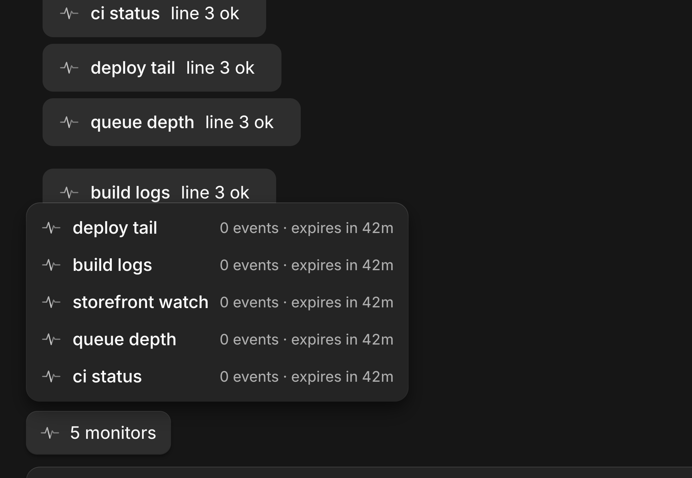

# Monitor

Start a command in the background and wake the session with its output as it happens, like Claude Code's Monitor tool.

> **Credit:** Idea and tool wording follow Claude Code's Monitor tool (Anthropic); the wrapper and untrusted-data trailer follow the `<cross-session-message>` pattern in [`orchestrator-tools`](../orchestrator-tools). No code was copied.




Chips animate in and out and the row moves with them: [recording](../native-ui/media/lane-chips.gif) ([mp4](../native-ui/media/lane-chips.mp4)).

## What it does
- The desktop UI marks monitors with a heartbeat (a fine ECG trace): while a monitor runs, a soft head of light sweeps along the trace every 2.4s, in the popover and timeline rows and on the composer chip, in phase everywhere (only the newest wake of a running monitor sweeps; older wakes stay still). When it has ended the trace flattens into a still line over 300ms. Reduced motion shows the trace at rest.
- `monitor.start` runs a shell command in the background. Each stdout/stderr line (optionally filtered by a regex) is an event; lines arriving close together become one message in the session, idle or busy, as `<monitor-event name="…" id="…" seq="N">` with a trailer saying the content is untrusted program output.
- One more message arrives when the command exits, with its exit code.
- `rearmMinutes` starts the command again every N minutes, ending a run that is still going (the "storefront watch" pattern). The old run's whole process group gets SIGTERM, then SIGKILL after the grace period, so subshells and `sleep`s end with it. The clock is saved: a service restart keeps the time left in the cycle (restart at minute 10 of 30: 20 left), and a restart after the mark counts as the re-arm (the restored process is fresh) with the next one set from then. Frequent restarts cannot starve it.
- `monitor.list` shows what is running (with `pid`, `lastRearm`, `nextRearm`, `restartCount`); `monitor.stop` ends a monitor and everything it started (SIGTERM to the process group, SIGKILL after a grace period).
- Monitors end when their session is archived or deleted, after `ttlMinutes` (default 24 h), and when the service shuts down. A plugin hot reload (the plugin module loaded again inside the running service, e.g. after a rebuild) is not a shutdown: the processes keep running and the new plugin instance adopts them, with the same pid and output, no restart count and no notice. `ttlMinutes` is the total lifetime from the first start: neither a re-arm nor a service restart extends it.
- `match` is applied to every line first. Only matching lines are events: batches hold matching lines only, and `maxEvents` and `maxEventsPerHour` count matching lines.
- `maxEvents` is a lifetime cap: the event count (what `events` shows in `monitor.list`) is saved with the monitor's state and keeps growing across re-arms and service restarts, so a monitor restored at 3 of 5 events has 2 left. It is saved with every wake, every minute and at clean shutdown; after a hard kill, events from the last seconds may be uncounted. A monitor that reached its cap is over and never restored. The `maxEventsPerHour` window is not persisted: it starts empty after a restart.
- `session` can name another session to wake, but only the caller's own tree: itself, its parent, its children and descendants, sessions it created through `orchestrator-tools`, and its siblings (the `parent`/`child`/`sibling` relations `list_peers` shows, the `tree` scope of `send_message`). Anything else is rejected with an error.
- A noisy monitor pauses with a notice after `maxEventsPerHour` lines; extra lines are counted, not shown.
- It tells the user, through the shared notifications hub in [`native-ui`](../native-ui/src/notify-contract.ts): a command that dies with a non-zero code or stops waking its session raises an error, the hourly cap a warning, and a restart, a loss or a normal end is info. With the [`notifications`](../notifications) plugin installed these follow its Settings > Notifications (plugins); without it each error or warning is a toast of the monitor's own with an Open button, and info stays quiet. Stopping a monitor yourself says nothing.

- In the desktop app a wake is not a raw user bubble: it is a grey row in the style of the host's subagent row with the monitor's name, what happened (`first line · N lines`, `restarted (restart 5)`, `ended`, `lost`, `paused`) and, when opened, the real output in a card below, unescaped, without the tags or the trailer. A Stop button on the row ends the monitor while it still runs. The model still receives the wrapped, escaped text.
- A "N monitors" chip sits in the row above the composer, beside the host's own "N subagents" capsule (same capsule, hidden at zero). It counts the monitors aimed at the session on screen, including ones another session started for it. Click it for a popover with one row per monitor, laid out like the host's own subagent popover: a spinner, its name and the status at the end (`3 of 50 events · re-arms in 12m · expires in 1h 5m`), which a Stop button replaces on hover or focus. The arrow keys move between rows (Right reaches Stop), Escape closes. Chips come and go with a short collapse (200ms) and the neighbours, the host's capsule included, slide to their new places; the popover's times tick over at minute boundaries while it is open.

The tool description tells the agent each output line is shown to you in a one-line row, so it should print short plain sentences (`Deploy #8216 succeeded in 4m`) rather than raw ids, timestamps or JSON. The row also rewords ISO timestamps and snake_case statuses in the header; hover it for the raw line, open it for the full text.

## Context
OpenCode's background shell only notifies when the command exits. This fills the gap for watchers, dev servers and polling loops.

Safety: the command goes through the host's normal `shell` approval (and `external_directory` for a `cwd` outside the session directory), asked on the calling session, so a session that may not run shell cannot start a monitor. Re-arm restarts and restores after a service restart reuse that first approval. Output is wrapped and escaped, but a model can still be influenced by what a program prints.

Only a real service restart (the service process itself ended, taking the commands with it) counts. Every monitor of a previous run still within its `ttlMinutes` and `maxEvents` is started again (its command runs fresh; one without `rearmMinutes` gets no re-arm clock), and the first wake says it was restarted: a `<monitor-notice … seq="N" restart="K">` with the window the service was down (from the last time it was known alive, which is a once-a-minute heartbeat and the clean shutdown; "unknown" when none was recorded). `seq` keeps counting across restarts, so no two wakes of a monitor share a number. One that is not restarted (ttl passed, event cap reached, or the service is at `maxMonitors`) wakes its session once with a `<monitor-notice>` saying it is gone and can be started again (same `seq`/`restart`/downtime fields) (nothing is sent if the session is archived or deleted). During a reload the old instance parks each monitor in a process-wide registry; the new instance of the monitor's directory claims it. One not claimed within 30 s (its instance never came back) is ended. A process that exits, or output that arrives, in the gap is replayed to the new instance. If the service is killed hard (SIGKILL, crash), running commands are orphaned: the plugin cannot reap what it cannot signal.

## Install
Register by absolute path in `~/.config/opencode/opencode.json`:
```json
"plugins": ["/path/to/apps/opencode-plugins/monitor"]
```
Kind: server and GUI. Restart the background service (quit the app, then `opencode service restart`); the service outlives the app, so quitting alone does not reload it.

The row needs the GUI export: the host decides a plugin's parts when the service starts, so a service started before this package had `./gui-experimental` shows the raw user bubble until `opencode service restart`.

## Options
| Option | Default | |
|---|---|---|
| `maxMonitors` | `5` | running monitors at once |
| `ttlMinutes` | `1440` | default auto-stop; the tool's `ttlMinutes` overrides |
| `maxEventsPerHour` | `200` | per monitor, then it pauses |
| `minRearmMinutes` | `1` | smallest `rearmMinutes` |
| `maxLinesPerWake` | `50` | lines per message; the rest are counted |
| `maxLineChars` | `2000` | longer lines are cut |
| `maxBufferBytes` | `65536` | unsent output held per monitor |
| `killGraceSeconds` | `5` | SIGTERM to SIGKILL |
| `logDir` | `~/.local/share/opencode/monitor` | `monitor.log` (lifecycle only, never output) |

## Credits
- [OpenCode](https://github.com/anomalyco/opencode) (MIT): the chip is the host's own `ComposerPill` capsule and popover (`session/composer/plugin-pills.tsx`, `composer-lane.css`); the popover rows follow its activity panel (`activity-chips.tsx`), from the renderer source (2.2.5). The chip's motion follows Emil Kowalski's animation rules ([emilkowalski/skills](https://github.com/emilkowalski/skills)): ease-out `cubic-bezier(0.23, 1, 0.32, 1)`, 200ms, no `scale(0)`, reduced-motion branch.
- [OpenCode](https://github.com/anomalyco/opencode) (MIT): the row's markup values (padding, radius, type, the trailing slot's reveal) follow the desktop app's background-subagent row, from its renderer source (2.2.5); the row itself is `native-ui`'s `InjectedMessageRow`.

## Development
`pnpm typecheck && pnpm test && pnpm build` (dist is tracked). Design notes: [DESIGN.md](DESIGN.md).
