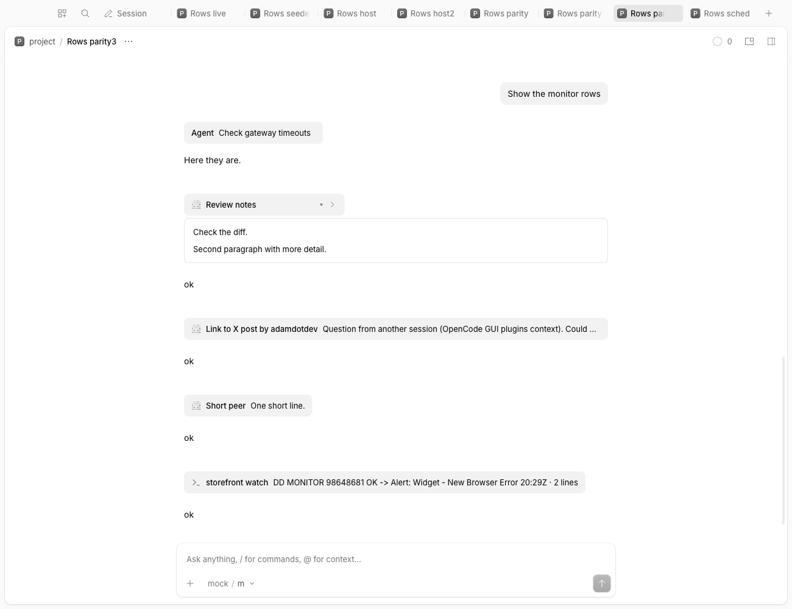
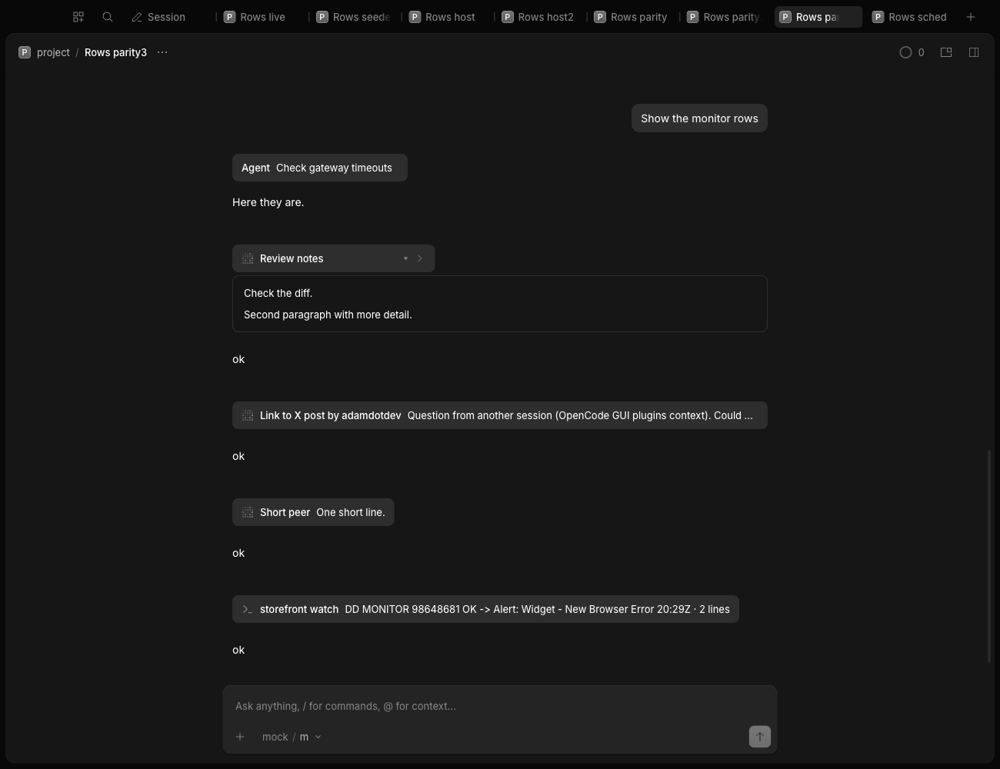
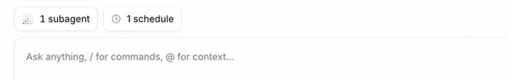

# native-ui

Shared components that look and behave like OpenCode Desktop's own sidebar rows, menus, popovers, spinners and icon buttons, for plugins to import.




## What it does
- Exports session tab rows, tab close and row-action buttons, menu content and items (with a submenu chevron and keyboard highlight), a popover, a summary card, project avatars, a progress spinner, a header icon button and a drawn clock icon.
- Uses the host's own class names and data attributes, so the app's CSS styles them. `nativeUiCss` adds the little the host does not provide.
- Imported by relative path and bundled into the importing plugin's build; `snooze-archive` (row styles) does, and `snooze-archive/src/menu.ts` re-implements part of the menu. It is not a plugin and is not registered. `demo/` is a separate demo GUI plugin.

- `InjectedMessageRow` and `mountInjectedRows`: a message an app injected into a session (peer, monitor wake, scheduled run) as the host subagent row's grey header with a card below when opened; used by `orchestrator-tools`, `monitor` and `scheduler`. Register `injectedMessageRowCss` with `ctx.add(Style, ...)`.

- `createTabMarks` and `tabMarkCss`: a labelled mark (info, success, warning, error glyph) in the trailing status slot of a vertical tab, for events that start no turn; generalised from the snooze clock, same box as the host's status slot (parity spec in `notifications/parity.spec.mjs`). `createDomHub` is the scoped sidebar observer it runs on (the same one `snooze-archive` has; see the TODO in its header).
- `createSessionChip`, `createLaneChip` and `LaneChipRows`: a chip in the row above the composer (the host's `ComposerPill`) that counts things aimed at the session on screen, opens a popover of one-line rows (name, trailing status, an action in its place on hover) that matches the host's own subagent popover, with arrow-key navigation, and collapses in and out while the row moves with it; used by `monitor` and `scheduler`. Register `laneChipCss` with `ctx.add(Style, ...)`.

- `notify-contract.ts` (import it by file path, it has no imports): the notifications hub convention. `notify(ctx, {kind, title, ...})` publishes a notification of kind `done`, `needs-you`, `error` or `info` to the [`notifications`](../notifications) plugin when it is installed, else shows the plugin's own toast with an Open button (`info` stays quiet); `notifyFromServer` does the same for what a server half emitted as the RPC event `notify`; `acquirePublisher` announces a source for the Settings page. The registry is on `globalThis` under a versioned `Symbol.for` key and survives hot reloads. Server bundles copy its payload shape instead of importing it.



## Context
GUI plugins that draw their own rows and menus drift from the app. These components copy the host's markup from the installed 2.2.5 renderer source, and `parity.spec.mjs` checks them against the real elements. It tracks 2.2.5 and may break on a host update.

## Install
Not registered. Import from a sibling plugin:
```ts
import { MenuContent, SessionTabRow, nativeUiCss } from "../../native-ui/src"
```
Kind: library. Rebuild the importing plugin.

## Options
None.

## Credits
- OpenCode (MIT): the markup, class names and layout of each component, adapted from the desktop app's renderer source (2.2.5) at https://github.com/anomalyco/opencode.

## Development
`pnpm typecheck && pnpm test` (no build; consumers bundle the source). Design notes: [DESIGN.md](DESIGN.md).

The spinner needs its keyframes: `ctx.add(Style, spinnerCss)`, or register `nativeUiCss`, which includes it.
