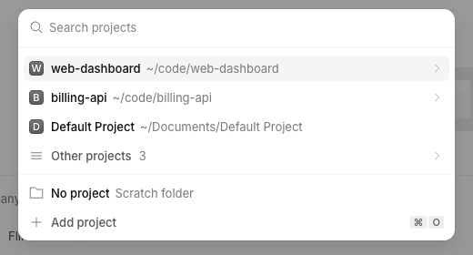

# No project

A "No project" row in the new-session project picker that opens a draft in its own empty scratch folder.

> **Credit:** inspired by [t3-code](https://github.com/pingdotgg/t3code)'s (MIT) "No project" scratch grouping for projectless threads. The folder-per-session model and the sweep are this plugin's own.



## What it does
- Adds **No project** (description "Scratch folder") directly above "Add project" in the picker, and a palette command "New session without a project" (`/no-project`).
- Each use creates `<data dir>/no-project/<uuid>/No project` and opens an unsent draft there. Every such session is labelled "No project" in the sidebar.
- A server entry deletes scratch folders that have no session after 24 hours, whose sessions are all archived for over 7 days, or whose session was deleted. A folder with a live session is never deleted.

## Context
OpenCode has no projectless session: without a location a session runs in your home directory, which is itself a project with its own config. A folder per session keeps sessions apart. Each folder becomes its own project and lists under "Other projects" in the picker. With a custom `XDG_DATA_HOME` the app cannot find the server's data dir, so folders are created but never swept.

## Install
Register by absolute path in `~/.config/opencode/opencode.json`:
```json
"plugins": ["/path/to/apps/opencode-plugins/no-project"]
```
Kind: GUI (`gui-experimental`) plus a server entry loaded from the same path. Cmd+R for GUI, restart the background service for the server entry (quit the app, then `opencode service restart`).

## Options
| Option | Default | |
|---|---|---|
| `directory` | none | absolute path of one shared scratch folder instead of one per session; it is never swept. A relative path or one with `.` or `..` segments fails the plugin at startup |

## Credits
- t3-code (MIT, pingdotgg/t3code): inspired by its treatment of projectless threads as a scratch project grouped under the label "No project" ([`projectGrouping.ts`](https://github.com/pingdotgg/t3code/blob/8760d063e903406c8e8f695b0852c0a15fc1e00f/packages/client-runtime/src/state/projectGrouping.ts)). The folder-per-session model and the sweep are this plugin's own.

## Development
`pnpm typecheck && pnpm test && pnpm build` (dist is tracked). Design notes: [DESIGN.md](DESIGN.md).
