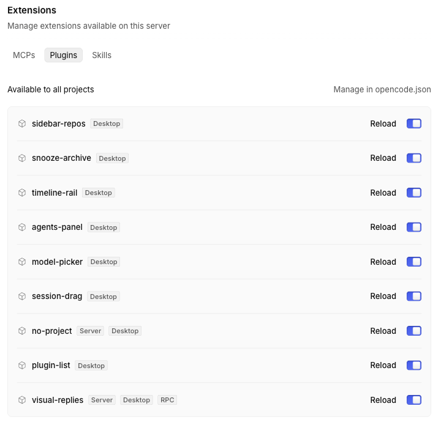

# Plugin list

Extensions → Plugins shows server-only plugins too, and tags every row with where it runs.



## What it does
- Lists plugins that have no desktop part, which the native page leaves out.
- Adds a chip to each row for the parts it has: Desktop, Server, TUI, RPC.

## Context
OpenCode's Plugins tab only lists plugins with a desktop part, so a server plugin looks missing and a plugin with several parts gives no hint which it has. The host has no slot for rows or chips on that page, so this adds them to its markup and removes them on cleanup. It tracks the 2.2.5 page.

## Install
Register by absolute path in `~/.config/opencode/opencode.json`:
```json
"plugins": ["/path/to/apps/opencode-plugins/plugin-list"]
```
Kind: GUI (`gui-experimental`) with a main-process helper that reads the config. Cmd+R for GUI.

## Options
None.

## Development
`pnpm typecheck && pnpm test && pnpm build` (dist is tracked).
