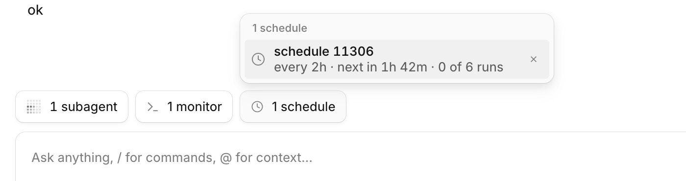
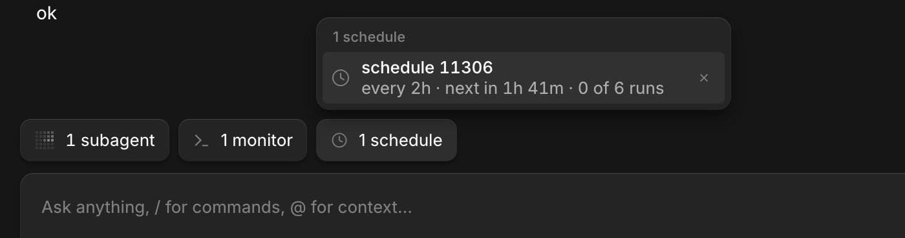

# Scheduler

Tools that let an agent schedule a prompt for later, once or on a repeat, and wake a session with it when it is due.




Chips animate in and out and the row moves with them: [recording](../native-ui/media/lane-chips.gif) ([mp4](../native-ui/media/lane-chips.mp4)).

## What it does
- `schedule_task` takes a prompt and exactly one of `at` (ISO time or `+2h`), `every` (`30m`, `2h`, `1d`) or `cron` (5 fields, your local time zone). It wakes the calling session, or another one by ref or title.
- `list_schedules` shows each task's id, name, kind, next and last run and target, plus recently ended tasks and why they ended.
- `cancel_schedule` removes a task by id.
- Tasks are saved, so they survive restarts and sleep. A run missed while the app was closed or the machine slept fires once when it is back (never one per missed slot), and the message says how late it was. Each scheduled slot is delivered at most once even when the server loads several plugin instances or restarts; a crash between claiming and sending skips that run rather than repeating it. Recurring tasks reschedule from the moment they ran.
- The wake arrives in the session straight away, idle or busy, as `<scheduled-task name="..." id="..." scheduled="...">prompt</scheduled-task>` plus a short note that it came from a scheduler, not from you at that moment.
- A task whose session was archived or deleted is dropped and the reason is listed. A task that fires more than 10 times in an hour is paused with a notice in its session.

- In the desktop app a scheduled run is not a raw user bubble: it is a grey row in the style of the host's subagent row with a clock icon, the task's name and `scheduled run`, and, when opened, the prompt as the user wrote it in a card below. A Cancel button on the row ends a repeating task that is still scheduled.
- A "N schedules" chip (clock icon, hidden at zero) sits in the row above the composer, beside the host's own "N subagents" capsule. It counts the tasks aimed at the session on screen, including ones another session scheduled for it. Click it for a popover with one row per task: its name, a muted line (`every 2h · next in 1h 47m · 2 of 6 runs`) and a Cancel button that appears on hover or focus. Chips come and go with a short collapse and the neighbours slide to their new places.

## Context
OpenCode has no scheduled or recurring jobs; Claude Code does. The tools appear in Code Mode as `tools.scheduler.schedule_task(...)`, `tools.scheduler.list_schedules()` and `tools.scheduler.cancel_schedule(...)`, like the `orchestrate_*` tools of [orchestrator-tools](../orchestrator-tools). Limits worth knowing: the server must be running to fire anything, and the plugin does not look at [usage-resume](../usage-resume) (see DESIGN.md).

## Install
Register by absolute path in `~/.config/opencode/opencode.json`:
```json
"plugins": ["/path/to/apps/opencode-plugins/scheduler"]
```
Kind: server and GUI. Restart the background service (quit the app, then `opencode service restart`); the service outlives the app, so quitting alone does not reload it.

The row needs the GUI export: the host decides a plugin's parts when the service starts, so a service started before this package had `./gui-experimental` shows the raw user bubble until `opencode service restart`.

## Options
Pass them with `{ "package": "/path/to/scheduler", "options": { ... } }`.

| Option | Default | |
|---|---|---|
| `maxSchedules` | `50` | tasks held at once |
| `minIntervalSeconds` | `60` | shortest gap between runs of a recurring task |
| `loopMaxFires` | `10` | fires allowed within `loopWindowMinutes` before a task is paused |
| `loopWindowMinutes` | `60` | |
| `tickSeconds` | `30` | longest wait before due tasks are looked at (also how fast a woken machine catches up) |
| `lateSeconds` | `90` | a run later than this is reported as late |
| `scope` | `"tree"` | which sessions `session` may name: the caller's tree, `"project"` or `"all"` |
| `logDir` | `~/.local/share/opencode/scheduler` | `scheduler.log` (prompts are never logged) and `claims/`, one empty file per delivered slot (pruned after 30 days) |

Per task, `maxRuns` stops a recurring task after that many runs.

## Credits
- [OpenCode](https://github.com/anomalyco/opencode) (MIT): the chip is the host's own `ComposerPill` capsule and popover (`session/composer/plugin-pills.tsx`, `composer-lane.css`); the popover rows follow its activity panel (`activity-chips.tsx`), from the renderer source (2.2.5). The motion follows Emil Kowalski's animation rules ([emilkowalski/skills](https://github.com/emilkowalski/skills)).
- [OpenCode](https://github.com/anomalyco/opencode) (MIT): the row's markup values (padding, radius, type, the trailing slot's reveal) follow the desktop app's background-subagent row, from its renderer source (2.2.5); the row itself is `native-ui`'s `InjectedMessageRow`.

## Development
`pnpm typecheck && pnpm test && pnpm build` (dist is tracked). Tests use a fake host and clock; cron tests set `TZ` to `Europe/London` for DST. Design notes: [DESIGN.md](DESIGN.md).
