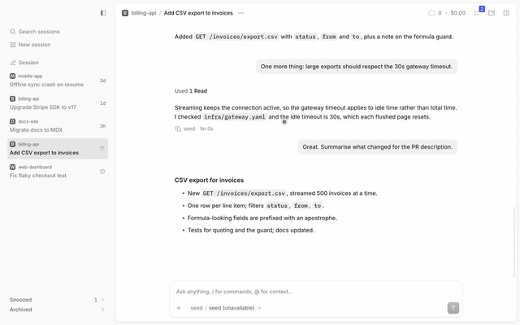

# Session drag

Drag a sidebar session row sideways into the chat to attach it as a "Session" chip the model can read.

> **Credit:** the drag image's classes, the drop overlay and the `@session` mention form come from [OpenCode](https://github.com/anomalyco/opencode)'s (MIT) desktop app (2.2.5). The enter curve and `scale(.97)` follow Emil Kowalski's animation guidance.



[Full-quality video](media/demo.mp4)

## What it does
- Press a session row in the sidebar (a live tab, or an Archived row from snooze-archive; Snoozed rows do not drag) and move sideways. A chip with the title follows the pointer and the native drop overlay rises over the session, worded "Drop to attach session".
- Release inside the session: a native "Session" chip joins the composer's context row and the prompt takes focus. Release elsewhere, or press Esc: nothing changes.
- The model receives `The user referenced session @session:<id> ("title").` The orchestrate tools take that id as is.
- Clicking the chip opens the session. A vertical move still reorders tabs and a plain click still switches.
- Palette: "Reference session…" picks a session by name and attaches the same chip.

## Context
Typing `@` in the composer already mentions a session, but only from the keyboard. The host blocks HTML drag and drop from sidebar rows, so this listens for pointer events ahead of the host's, decides sideways or vertical on the first 4px, and attaches the chip through the composer's public API. The limit: the drop target is the session panel, not the composer box.

## Install
Register by absolute path in `~/.config/opencode/opencode.json`:
```json
"plugins": ["/path/to/apps/opencode-plugins/session-drag"]
```
Kind: GUI (`gui-experimental`). Cmd+R for GUI.

## Options
None.

## Credits
- [OpenCode](https://github.com/anomalyco/opencode) (MIT): the drag-image classes (verbatim), the drop overlay and the `@session:<id>` mention form, from the desktop app's renderer source (2.2.5).
- Emil Kowalski: the ghost's enter curve `cubic-bezier(.23,1,.32,1)` and `scale(.97)` start, from his animation guidance (the `animation` skill reference).

## Development
`pnpm typecheck && pnpm test && pnpm build` (dist is tracked). Design notes: [DESIGN.md](DESIGN.md).
