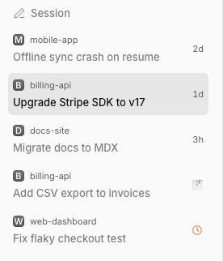

# Sidebar repos

Two-line sidebar rows: the project name above the session title, a status icon for pending approvals and the time of the last activity on idle rows.

> **Credit:** the trailing-edge fade mask follows the shape of [OpenCode](https://github.com/anomalyco/opencode)'s (MIT) own sidebar row mask (2.2.5).



## What it does
- Each session row shows the project's name (middle-truncated, full text on hover) above the title.
- A pending permission request shows the app's warning icon, a pending question the help icon. The blue unread dot and busy ring stay native.
- Idle rows show the age of the last user or assistant message at the end (`now`, `5m`, `2h`, `3d`, `2w`, `4mo`). Hovering swaps it for the close button; hover text has the full date. Rows with a status mark show none.
- Other plugins can set `data-sidebar-active-at="<epoch ms>"` on a row to get the same time (snooze-archive does for Archived rows).
- Hides the Home row (it has a keybind) and removes the list's own edge fades. Row text fades at the trailing edge instead, so marks and times stay visible.

## Context
The native row shows the title only, so sessions from different projects read alike. The host has no slot for a row's label, so this injects a sibling node and removes it on cleanup; app text is never rewritten. Only the vertical (Side tabs) layout is changed.

## Install
Register by absolute path in `~/.config/opencode/opencode.json`:
```json
"plugins": ["/path/to/apps/opencode-plugins/sidebar-repos"]
```
Kind: GUI (`gui-experimental`). Cmd+R for GUI.

## Options
None.

## Credits
- [OpenCode](https://github.com/anomalyco/opencode) (MIT): the shape of the trailing-edge `mask-image` rule (16px ramp over the link), from the desktop app's sidebar row (2.2.5).

## Development
`pnpm typecheck && pnpm test && pnpm build` (dist is tracked). Design notes: [DESIGN.md](DESIGN.md).
