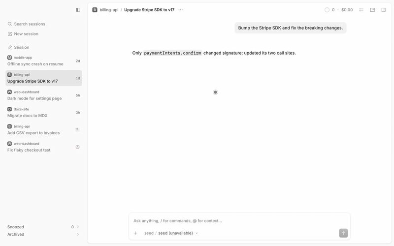

# Snooze / archive

Snoozed and Archived groups at the bottom of the sidebar, with Snooze and Archive next to Delete in every session menu.



[Full-quality video](media/demo.mp4)

## What it does
- **Snooze** is a submenu of the session right-click menu, the session header "…" menu and the Home row menu: In 1 hour, In 3 hours, This evening, Tomorrow, Next week, each with its wake time, then Custom… (duration or calendar and time). The palette has "Snooze session…".
- A snoozed session wakes at its deadline or when it needs attention (approval, question, new work, completion). It then shows a clock until you open it. Snoozes are stored on this device and survive restarts.
- **Archive** and **Restore** use OpenCode's native archive state. Opening an archived row reads it without unarchiving. Snoozed and Archived rows have Wake, Restore and Delete… (always confirmed) in their own menus.
- Archived loads lazily. Each group shows 10 rows, and **Show N more** adds the next 25. The count reads `10+` until the last page arrives.
- The groups scroll with the live rows inside the sidebar. Expanding one grows it upward into the empty space first, then downward. Rows never move.

## Context
OpenCode Desktop archives sessions but has no snooze, and no way to browse a long archive. This adds both inside the sidebar. The host has no slot there or a hook for the tab menu, so the groups and menu items are injected into its DOM and removed on cleanup. This tracks the 2.2.5 markup. Closing a snoozed or archived tab can leave an entry in native Recently closed.

## Install
Register by absolute path in `~/.config/opencode/opencode.json`:
```json
"plugins": ["/path/to/apps/opencode-plugins/snooze-archive"]
```
Kind: GUI (`gui-experimental`). Cmd+R for GUI. The groups need the Side tabs layout; the palette commands work in any layout.

## Options
| Option | Default | |
|---|---|---|
| `archive` | `auto` | `auto`: stand down when OpenCode shows its own archive UI. `ours`: always show ours. `theirs`: always stand down. |

```json
"plugins": [{ "package": "/path/to/apps/opencode-plugins/snooze-archive", "options": { "archive": "theirs" } }]
```

## When OpenCode adds archive UI
OpenCode 2.2.5 stores archived sessions but has no archive UI in its Side tabs sidebar, its menus or its palette. Its experimental Inbox layout has an Archived section and an Archive menu item of its own; that layout shows none of this plugin's groups, so it does not count. In `auto` the plugin watches for the host's own:

- **Command**: a bound `session.archive` or `session.unarchive` keybind.
- **Menu**: a session menu (tab, header, Home row) that already has an Archive or Unarchive item. Our menu item is then left out of that menu.
- **Sidebar**: an archived group inside the Side tabs sidebar (`data-slot` or `data-component` containing `archived`).
- **Home**: the Home row's `data-action="home-session-archive"` button.

Any one of them makes the **Archived** group, the **Archive** menu items, the hover Archive button (the host's close X comes back), the Archive and Refresh palette commands, and the Snoozed row's Archive stand down. Snooze, the Snoozed group, Delete…, waking when a session is archived elsewhere, and the woke mark stay. It is live: the group stays mounted but hidden, nothing is fetched while it is down, and it comes back, and loads what it missed, when the host's UI goes away. The reading is on the sidebar root as `data-sa-archive="ours|theirs"`.

Archive and Restore call the client's own `session.archive` / `session.unarchive` when it has them, else `session.update({ archived })`, then check the server's state.

### Re-check on each OpenCode update
- **SDK**: do `client.session.archive` / `unarchive` exist, and with which argument (the plugin assumes `{ sessionID }` and falls back to `update` on any error)? Does `session.list({ archived: true })` still work?
- **Commands**: the id the host gives its archive command. The plugin only knows `session.archive` and `session.unarchive` (`HOST_COMMANDS` in `src/guard.ts`); no registry lists the host's commands.
- **Menus**: the label or `data-action` of the host's Archive item in the tab, header and Home row menus (`hasNativeArchive`).
- **Sidebar**: the `data-slot` / `data-component` of an archived group in the Side tabs sidebar (`SIDEBAR_ARCHIVED`). The probe is scoped to `[data-slot="vertical-tabs-sidebar"]`.
- **Home**: whether `SHOW_HOME_SESSION_ARCHIVE` is on (`home-session-archive`).
- **Layouts**: whether the Inbox layout's Archived section moves into Side tabs.

## Development
`pnpm typecheck && pnpm test && pnpm build` (dist is tracked). Design notes: [DESIGN.md](DESIGN.md).
