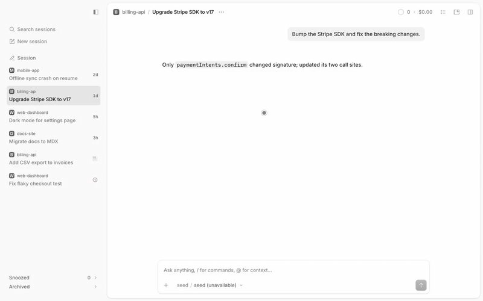

# Snooze

A **Snoozed** group at the bottom of the sidebar, and **Snooze** in every session menu.



[Full-quality video](media/demo.mp4)

## What it does
- **Snooze** is a submenu of the session right-click menu, the session header "…" menu and the Home row menu: In 1 hour, In 3
  hours, End of workday, Tomorrow, Next week, each with its wake time, then Custom… (duration or calendar and time). The palette
  has "Snooze session…".
- A snoozed session wakes at its deadline or when it needs attention (approval, question, new work, completion). It then shows a
  clock until you open it (with the [notifications](../notifications) plugin installed the wake is published as an info
  notification and its tab mark replaces the clock). Snoozes are stored on this device and survive restarts.
- **Sending a message** into a snoozed session unsnoozes it at once, and clears any woke clock. Messages from anything else
  (assistant output, subagents, peer messages, monitor and scheduler wakes) never unsnooze; they wake it as before.
- Snoozed rows are ordered by when they wake, the soonest at the top, and they don't drag. The group shows 10 rows and
  **Show N more** adds the next 25.
- A snoozed session that was archived elsewhere stops being snoozed. Archive state is the host's: this plugin reads it, and
  its Snoozed row's **Archive** writes it through the native API. Snoozing an archived session is refused until it is restored.

## Independent of the archive plugin
Snooze works on its own: the Snoozed group, its rows and its menus never need `archive` installed. The row menu's **Archive**
uses the native API directly. With both installed you also get the Archived group, the Archive action on every tab and the
menu items — and only the snooze plugin publishes the palette's **Delete session…**, so the two never list it twice.

## Install
Register by absolute path in `~/.config/opencode/opencode.json`:
```json
"plugins": [
  "/path/to/apps/opencode-plugins/snooze",
  "/path/to/apps/opencode-plugins/archive"
]
```
Kind: GUI (`gui-experimental`). Cmd+R for GUI. The group needs the Side tabs layout; the palette command works in any layout.
The two plugins are separate: leave `archive` out and only Snoozed exists.

## Options
None.

## When OpenCode adds snooze
Nothing to stand down for: 2.2.5 has no snooze state. If a release adds one, this group and its menus would need the same
stand-down treatment the archive plugin has.

## Re-check on each OpenCode update
- **Composer stamp**: `session.inbox.enqueued` items from the composer carry `payload.metadata.displayText` (`isUserSend` in
  `session-ui`); other senders stamp their own keys. If a release drops it, sends stop resetting the state.
- **Menus**: the shape this plugin looks for — a session menu ending in a Delete… item alone after a separator
  (`src/sessionmenu.ts` in `session-ui`).
- **Events**: `session.execution.*`, `permission.asked`, `form.created`, `session.archived`, `session.deleted`.
- **Layouts**: whether the Inbox layout's session list moves into Side tabs.

## Credits
- [OpenCode](https://github.com/anomalyco/opencode) (MIT): the session menu markup, adapted from the desktop app's renderer
  source (2.2.5).

## Development
`pnpm typecheck && pnpm test && pnpm build && pnpm smoke` (dist is tracked). Design notes: [DESIGN.md](DESIGN.md). The shared
sidebar and menu code is [session-ui](../session-ui); install once in `apps/opencode-plugins`.
