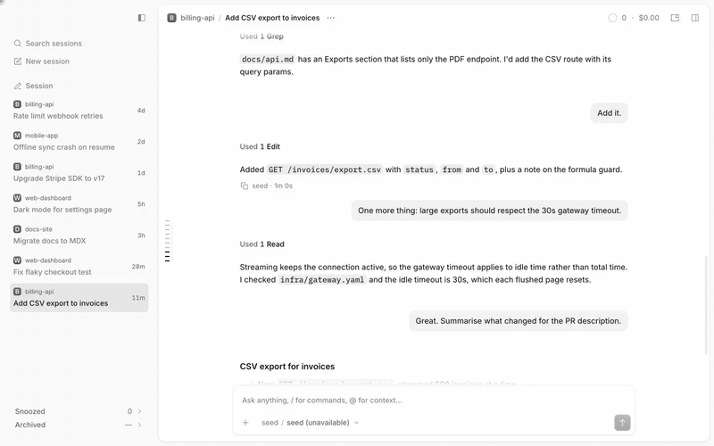

# Timeline rail

A column of ticks in the chat's left gutter, one per prompt of yours (messages another session sent through orchestrator-tools are not prompts and get no tick), with a card on hover and a click that lands the prompt under the header.

> **Credit:** layout, scale model, fisheye, card, chevrons, keyboard and history window are adapted from [t3-code](https://github.com/pingdotgg/t3code)'s (MIT) `TimelineMinimap`. The copyright notice is in [THIRD-PARTY.md](THIRD-PARTY.md).



[Full-quality video](media/demo.mp4)

## What it does
- One tick per prompt, 8px apart (at most the window height minus 18rem, then they overlap). Nothing shows under two prompts.
- Point at the strip: the tick and two neighbours each side stretch, and a card shows the prompt and the end of the reply, at once. Click, Enter or Space jumps to it.
- One tick is lit: the prompt whose turn you are reading (the last prompt at or above a line just under the header, so a long reply keeps its prompt lit; the last prompt when everything fits or you are at the bottom, the first at the top). The stretch of ticks is centred on it. Previous / next turn chevrons step from it and appear when you point at them, above and below the strip.
- Keyboard on the strip: arrows, Home, End, Enter. The wheel over the rail scrolls the chat.
- Covers the newest 10 prompts of a conversation and grows only when you scroll up and OpenCode loads older ones. It never asks for history itself.

## Context
OpenCode Desktop has no way to see the shape of a long conversation. This copies the minimap in t3-code's message timeline, including its limit: it knows what is loaded, not the whole history, so it appears at once and never grows after opening. A prompt older than what is loaded has no tick; scroll up and it gets one.

## Install
Register by absolute path in `~/.config/opencode/opencode.json`:
```json
"plugins": ["/path/to/apps/opencode-plugins/timeline-rail"]
```
Kind: GUI (`gui-experimental`). Cmd+R for GUI.

## Options
None.

## Credits
- t3-code (MIT, pingdotgg/t3code): the minimap's layout, scale model, fisheye, card, chevrons, keyboard and history window, adapted from [`TimelineMinimap.tsx`](https://github.com/pingdotgg/t3code/blob/8760d063e903406c8e8f695b0852c0a15fc1e00f/apps/web/src/components/chat/TimelineMinimap.tsx), [`MessagesTimeline.logic.ts`](https://github.com/pingdotgg/t3code/blob/8760d063e903406c8e8f695b0852c0a15fc1e00f/apps/web/src/components/chat/MessagesTimeline.logic.ts) and [`threadHistoryPaging.ts`](https://github.com/pingdotgg/t3code/blob/8760d063e903406c8e8f695b0852c0a15fc1e00f/apps/server/src/orchestration-v2/threadHistoryPaging.ts).

## Development
`pnpm typecheck && pnpm test && pnpm build` (dist is tracked). Design notes: [DESIGN.md](DESIGN.md).
