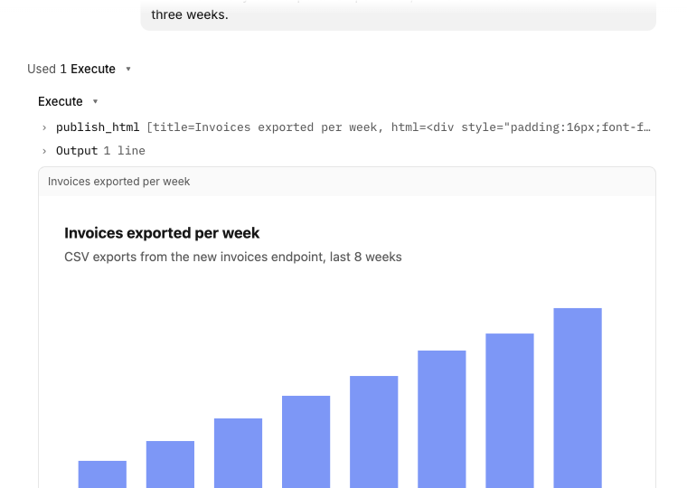

# Visual replies

Agents answer with a chart, table, diagram or mockup that renders inline in the timeline.



## What it does
- Adds the tool `publish_html` (`title`, `html`, optional local `images` embedded as data URIs) and tells the agent to use it when a picture beats prose.
- The page shows as a card under the tool row, in a sandboxed iframe with no network access. Zoom and expand are on the card.
- When the tool runs inside Execute, which OpenCode folds into a collapsed "Used N Execute" row, the row opens once so the page is visible. Close it and it stays closed.
- The page uses the app's light and dark colours and fonts through variables (`--bg`, `--fg`, `--accent`, `--font` and others).
- Pages are stored in plugin storage and deleted with their session.

## Context
Agent replies are text. The host has no hook for custom content in the timeline, so a server tool stores the page and the GUI part inserts a card after the tool row. The page can only talk to the app through a few validated messages (height, ready, open link). The auto-open clicks the host's own disclosure, since 2.2.5 has no setting for it.

## Install
Register by absolute path in `~/.config/opencode/opencode.json`:
```json
"plugins": ["/path/to/apps/opencode-plugins/visual-replies"]
```
Kind: GUI (`gui-experimental`) and server in one package. Restart the app for the server part, Cmd+R for GUI.

## Options
None.

## Development
`pnpm typecheck && pnpm test && pnpm build` (dist is tracked). Design notes: [DESIGN.md](DESIGN.md).
